# Using Bentobox

Bentobox is a Mac app and one or more **Bento** boards on your desk. A board shows a Toggl timer, a Pomodoro, a clock and your coding agents. The Mac app talks to Toggl, to speech-to-text and to your agents, and reaches the boards over Bluetooth.

This guide is about using them every day. To build the firmware and flash a board, start with the [README](../README.md).

The pictures come from the simulator, which runs the boards' own software, so they show what a board shows. Where there are two, the round one is the **Knob** (a round screen with a rotary knob) and the square one is the **Square** (an AMOLED screen with three buttons).

<p align="center">
  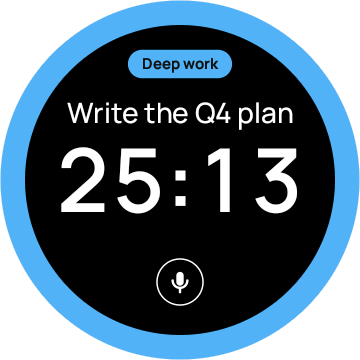
  &nbsp;
  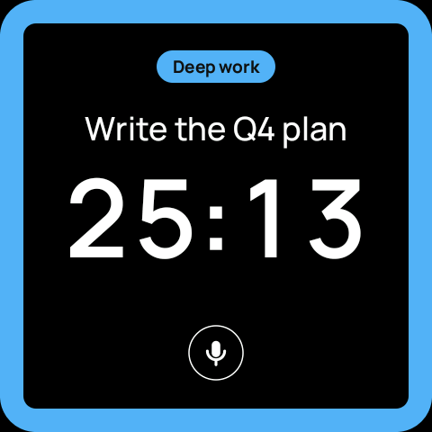
</p>

## Contents

- [Set up once](#set-up-once)
- [Getting around](#getting-around)
- [The menu](#the-menu)
- [Timer](#timer)
- [Projects and tasks](#projects-and-tasks)
- [Voice](#voice)
- [Pomodoro](#pomodoro)
- [Agents](#agents)
- [Split view](#split-view)
- [Clock](#clock)
- [Lock](#lock)
- [Settings](#settings)
- [Several boards](#several-boards)
- [The Mac app, day to day](#the-mac-app-day-to-day)
- [When something's wrong](#when-somethings-wrong)

## Set up once

**Try it without a board first.** The simulator opens the board in a Mac window, with sample agents. Click to tap, press and hold to hold, drag to swipe, and use the scroll wheel or the arrow keys as the knob.

```sh
tools/bento sim knob-lcd-1.8 --demo      # or amoled-2.16
```

Then set up the Mac app. Run these from the repo root. You need Python 3.10 or newer and the Xcode command-line tools.

1. **Install it** and create its config:

   ```sh
   python3 desktop/install.py setup
   desktop/.venv/bin/python desktop/bentobox.py init
   ```

2. **Save your keys** in the macOS Keychain. Each command asks for the key and doesn't show what you paste. Both are optional: the Toggl key is for time tracking, and the speech key, an OpenAI API key, is for voice.

   ```sh
   desktop/.venv/bin/python desktop/bentobox.py set-key toggl
   desktop/.venv/bin/python desktop/bentobox.py set-key speech
   ```

   If Bentobox can't find your Toggl organization by itself, give it the id: the first number in `focus.toggl.com/<organization>/workspaces/...`.

   ```sh
   desktop/.venv/bin/python desktop/bentobox.py set-org 12345
   ```

3. **Run it,** and allow Bluetooth if macOS asks:

   ```sh
   desktop/.venv/bin/python desktop/bentobox.py run
   ```

4. **Pair each board.** On the board, open **Settings › Connectivity › Pair a new Mac**. The board shows a 6-digit code for two minutes: type it into the dialog that macOS opens. Then trust the board on the Mac:

   ```sh
   desktop/.venv/bin/python desktop/bentobox.py boards trust
   ```

   If more than one new board is waiting, name the one to trust: `boards trust UID`. Plain `boards` lists them.

   <p align="center">
     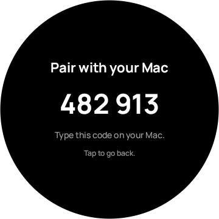
     &nbsp;
     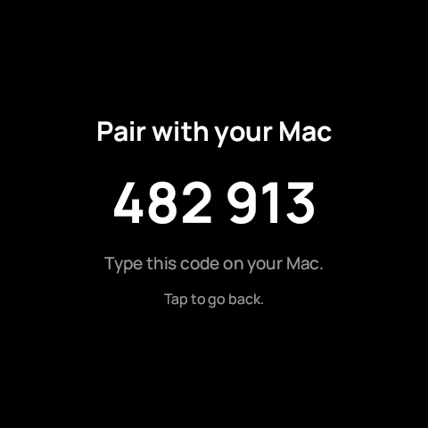
   </p>

   A real code only ever appears on the board's screen. The pictures show the simulator's sample code.

5. **Keep it running, if you like.** Bentobox can start when you log in, and hooks can tell it about your agents the moment something happens. Both change your setup, so read [Run it in the background](../desktop/README.md#run-it-in-the-background) first.

## Getting around

| To | On the Knob | On the Square |
|---|---|---|
| Open the menu | Swipe up | Swipe up |
| Go back, or close a list or the menu | Swipe down | Swipe down |
| Start or pause a clock, or choose something | Tap | Tap |
| Reset a clock | Press and hold until the ring closes | Press and hold until the ring closes |
| Set a value, or move through a list | Turn the knob | Drag sideways on a clock; drag a list up or down |
| See the next or previous agent | Turn the knob, or swipe left or right | Swipe left or right |
| Open Settings | From the menu | From the menu, or press **PWR** |
| Change the volume | No speaker: it vibrates instead | **User** for louder, **BOOT** for softer |

The Knob answers with a vibration and the Square with a sound. A short bump means that did nothing here, such as turning the knob while a Pomodoro runs. Holding **PWR** on the Square turns it off.

## The menu

Swipe up from anywhere for the Bento box: six compartments with color icons. Tap one to open it. Swipe down to close the menu.

<p align="center">
  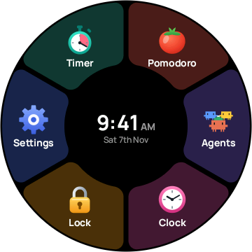
  &nbsp;
  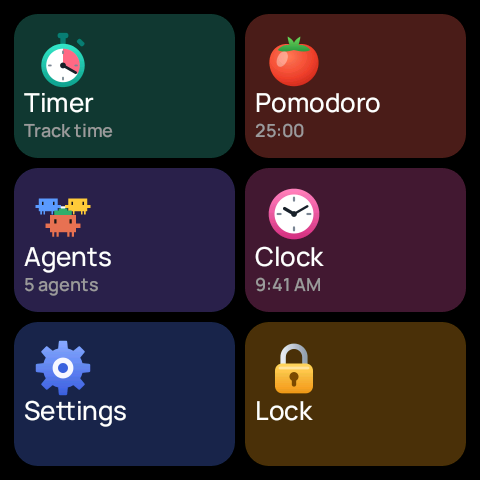
</p>

On the Knob the compartments circle the time and the date. On the Square they're tiles, each with a line of its own: the Pomodoro's length, how many agents there are, and the time.

Only one clock runs at a time. While the Timer runs, opening the Pomodoro says "Pause to switch", and the other way round.

## Timer

The Timer tracks your time in Toggl. The rim takes the project's color.

| 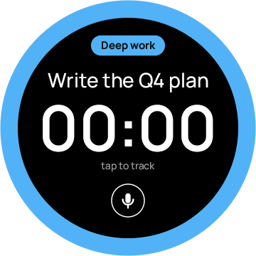 |  | 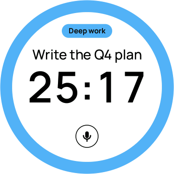 |
|:-:|:-:|:-:|
| At rest, with a project and a task | Running | The Inverted color profile |

- **Tap** to start, and tap again to pause. Each running stretch becomes its own Toggl entry. A timer stopped within 10 seconds of starting is deleted, in case the tap was an accident.
- **Forgot to start it?** While it runs, turn the knob clockwise: each click moves the start a minute earlier. Anticlockwise moves it back, but never past the start of this stretch. On the Square, drag sideways.
- **Press and hold** to reset. A thin ring fills from twelve o'clock, and when it closes, the Timer goes back to 00:00 and clears the task and the project.
- **Swipe down** to check Toggl. If a timer is running somewhere else, on your phone for example, the board switches to it and counts on.
- **No Mac?** The board keeps counting and saves its Toggl changes until the Mac is back. The status line says "no Mac: saved for later".

Bentobox never stops a Toggl timer it didn't start. If your phone's timer is running when you start one on the board, the phone's keeps going, and the board logs its own run as a finished entry when you stop it.

## Projects and tasks

On the Timer or the Pomodoro, tap the colored **project pill** for your projects, or the **task** above the time for your recent tasks.

| 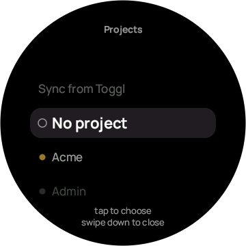 | 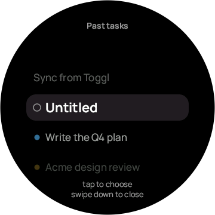 | 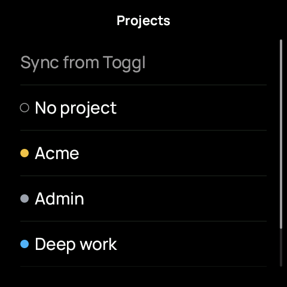 |
|:-:|:-:|:-:|
| Projects, on the Knob | Past tasks, on the Knob | Projects, on the Square |

- **With the knob,** turn to a row, then tap. A tap without a turn only closes the list.
- **On the Square,** drag to scroll, and tap a row.
- **Sync from Toggl,** the first row, fetches fresh lists from Toggl. Otherwise the lists come from the board's own memory, so they open at once and work with no Mac. Bentobox asks Toggl only when you do, because Toggl's free plan allows few requests.
- **No project** and **Untitled** clear the choice.
- Picking a past task also picks its project.

## Voice

Tap the **mic** and say what you're working on, then tap anywhere to stop. Your words become the task, and a project you name becomes the project. This needs the speech key on the Mac.

<p align="center">
  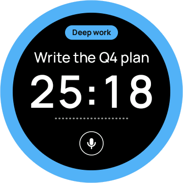
</p>

While it listens, a wave under the time moves with your voice. The Mac sends the clip to speech-to-text and never logs or saves what you said. The mic can pick up conversations in the room, so it listens only after you tap it.

## Pomodoro

The Pomodoro counts down from 1 to 60 minutes, and logs its running time to Toggl too.

| 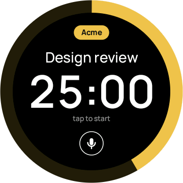 | 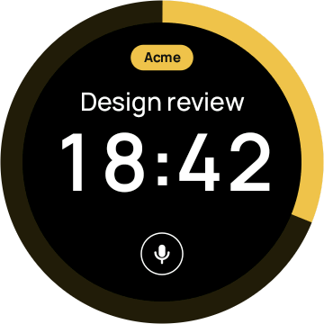 | 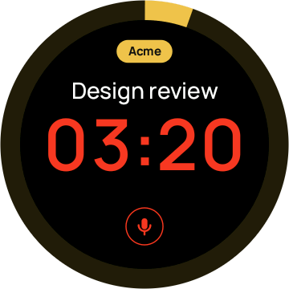 |
|:-:|:-:|:-:|
| Set to 25 minutes | Running | Under 5 minutes: orange, then crimson |

- **Set the length** before you start: turn the knob, or drag sideways on the Square. The rim shows the time out of 60 minutes.
- **Tap** to start or pause. While it's paused, turning sets the time left to a whole minute. While it runs, turning only says "pause to adjust".
- **From 10 minutes left,** the time, the status and the mic warm from white to orange at 5:00, then to crimson at 1:00. In the last minute the time pulses.
- **Time's up:** the board shows it wherever you are, and rings or vibrates. Any touch or turn stops the alarm, and a tap resets the Pomodoro for the next round.
- **Press and hold** to reset, as on the Timer.

<p align="center">
  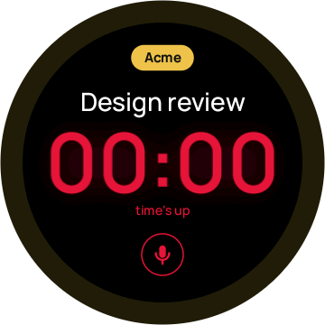
  &nbsp;
  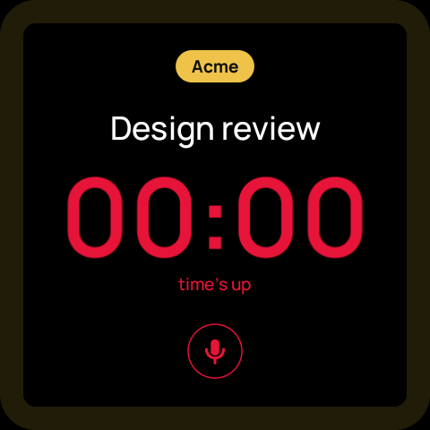
</p>

## Agents

Bentobox watches your Claude Code, Codex and Grok sessions and shows them on the board as pixel characters, one at a time.

| 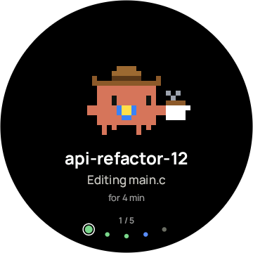 | 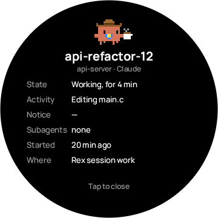 | 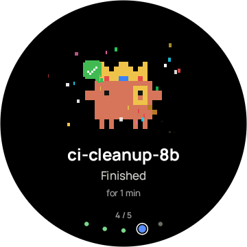 |
|:-:|:-:|:-:|
| An agent at work | Hold for its details | Finished: confetti |

- **Turn the knob, or swipe left or right,** for the next agent. The dots underneath show the others' status, and the count says where you are, like `1 / 5`. With hundreds of agents the dots become an endless strip: spin the knob faster to go further, or on the Square drag sideways to scrub and flick.
- **Tap** the character to bring its terminal pane to the front in [Rex](../README.md#what-you-need). An agent running in the background has no pane.
- **Hold** for its details card: what it's doing, its subagents, when it started and where it runs. Tap to close it.
- The agent on screen celebrates when it finishes, goes up in a puff of smoke when it ends, and dozes when it's idle.
- **Auto-scroll,** in Settings › Agents, moves to the next agent every 8 seconds. After you pick one yourself, it waits 20 seconds. Agents that need you come first.

**When an agent needs you,** waiting for your answer, the screen glows amber around the edge, and the Timer's or Pomodoro's status line names it.

<p align="center">
  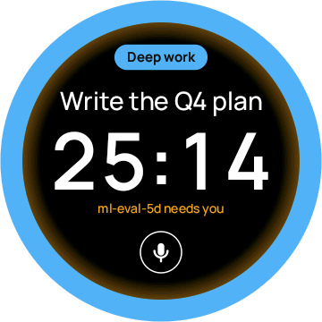
  &nbsp;
  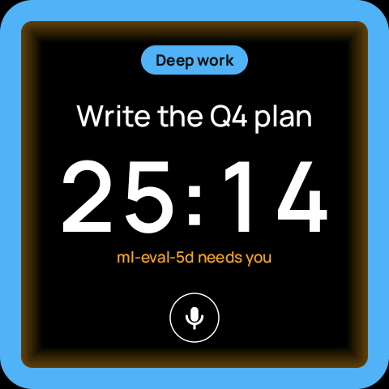
</p>

## Split view

While the Timer or the Pomodoro runs, it can shrink to the top of the screen, with Agents or the Clock below. Open Agents or the Clock from the menu while a clock runs. Split view keeps whichever of the two you opened last. Tap the top part to go back to the full clock.

| 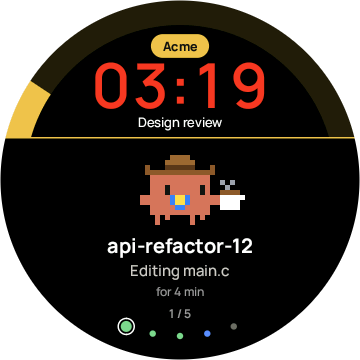 | 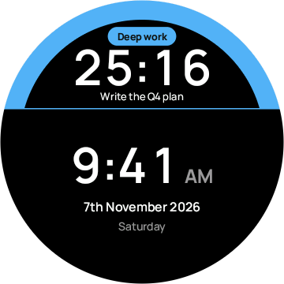 | 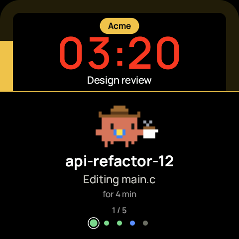 |
|:-:|:-:|:-:|
| A Pomodoro over Agents | The Timer over the Clock | On the Square |

Over Agents, the Pomodoro's arc shows how much of this countdown is left, whatever its length.

With **Auto switch** on, in Settings › Timer & Pomodoro, a full Timer or Pomodoro left untouched moves to Split view by itself. It waits 15 seconds, or what you set in **Switch after**, from 5 seconds to 5 minutes. With Auto switch off, the full clock stays until you leave it.

## Clock

The time, the date and the day.

<p align="center">
  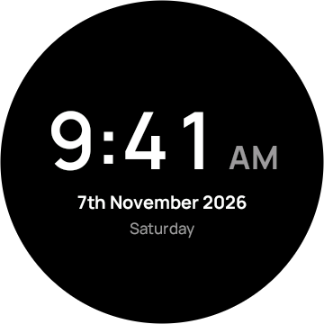
  &nbsp;
  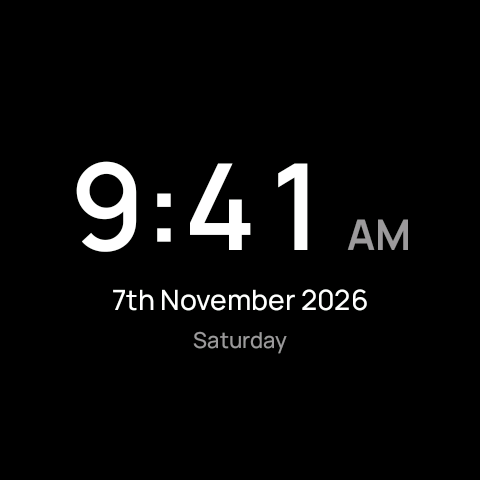
</p>

The board gets the time from the Mac, so until a Mac has connected, there's no time to show.

## Lock

Lock keeps the board to yourself. Set a 4-digit code on the Mac, once. Every board gets it when it next connects.

```sh
desktop/.venv/bin/python desktop/bentobox.py lock-code set
```

Then choose **Lock** in the menu. With no code set, the board says "Set a code on your Mac" and doesn't lock.

| 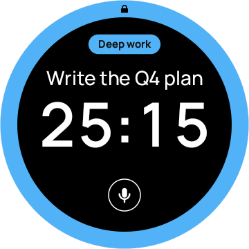 | 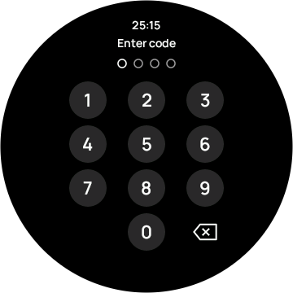 | 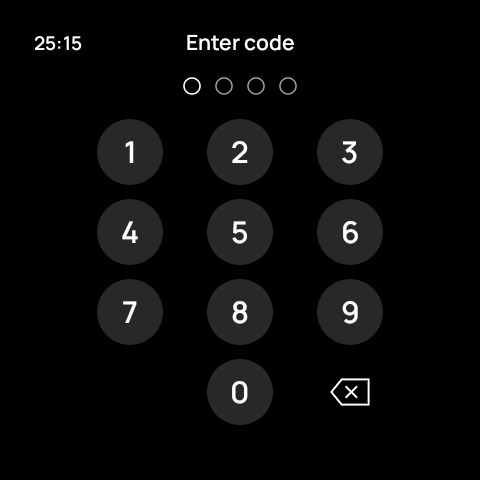 |
|:-:|:-:|:-:|
| Locked: the screen stays, with a lock at the top | The first touch brings up the keypad | The keypad on the Square |

- A locked board keeps showing its screen, and clocks keep running.
- The first touch or turn only brings up the keypad. Type the code by touch: the knob doesn't enter digits. After 10 seconds without a touch, the keypad goes away and clears what you typed.
- After wrong codes you have to wait a while, and longer each time.
- While locked, the board makes no sound, not even the time's-up alarm. Vibration stays on.
- **Forgot the code?** Set a new one from the Mac. It replaces the old one, even on a locked board. `lock-code remove` removes the code, which also unlocks the board.

The lock keeps out a passer-by. It isn't strong security, so don't reuse a real PIN.

## Settings

Settings has four groups. Tap a group to open it, and swipe down to go back up a level. Each board keeps its own settings, and shows only the rows it has the hardware for.

| 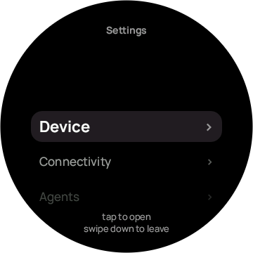 | 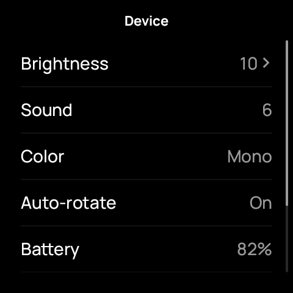 | 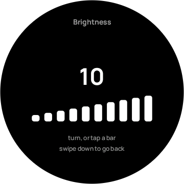 |
|:-:|:-:|:-:|
| The groups | Device, on the Square | Brightness |

- **Device:**
  - **Brightness:** ten levels, dim enough for a dark bedroom. Turn the knob or tap a bar.
  - **Sound:** the Square only.
  - **Color:** Mono, or Inverted (black on white).
  - **Auto-rotate:** the Square only. The screen turns with the board.
  - **Battery**, **Firmware** and **MAC address**.
- **Connectivity:**
  - **Connected to:** the Macs this board knows. Tap one to choose it. To forget one, hold it, then tap again.
  - **Pair a new Mac.**
- **Agents:** **Auto-scroll**.
- **Timer & Pomodoro:** **Split view** (Agents or Clock), **Auto switch**, and **Switch after**, which shows only while Auto switch is on.

<p align="center">
  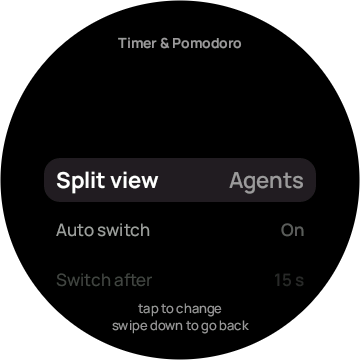
  &nbsp;
  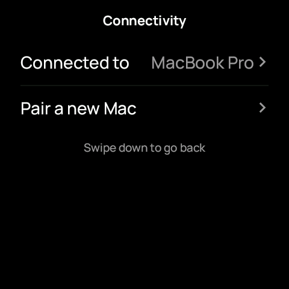
</p>

## Several boards

One Bentobox runs any number of boards at once: pair each of them. The Timer, the Pomodoro, the task and the project are the same on every board. Start, pause, reset or change them on any board and the others follow, and it stays one Toggl entry. If two boards change at once, the newer change wins. A board that was away catches up when it reconnects.

Brightness and the other settings, the agent on screen, the menus and the lock stay separate on each board.

## The Mac app, day to day

Use `desktop/.venv/bin/python desktop/bentobox.py` followed by:

| Command | What it does |
|---|---|
| `run` | Runs the app until you stop it |
| `status` | Shows the boards, Toggl, voice and your agents |
| `key-status` | Says which keys are set, never what they are |
| `set-key toggl` or `set-key speech` | Saves a key in the Keychain |
| `lock-code set` or `lock-code remove` | Sets or removes the boards' lock code |
| `boards` | The boards this Mac trusts, and new ones waiting |
| `boards trust [UID]` or `boards forget UID` | Trusts a board, or forgets one |

If launchd runs the app, its log is in `~/Library/Logs/bentobox.log`.

**What stays private:**

- Your keys stay in the macOS Keychain. They never appear on a command line, in a log or on a board.
- A board has no Wi-Fi and no keys. It keeps only its Bluetooth pairing keys and a salted hash of the lock code.
- Hooks send Bentobox only short, safe fields about your agents: never prompts, commands, file contents, full paths or tool output.
- Voice transcripts are never logged or saved.

## When something's wrong

| What you see | What to do |
|---|---|
| The board says "Mac offline" | Check that Bentobox is running on the Mac, and that the board is in range. The board keeps counting, and sends its changes when the Mac is back. |
| `no Bento board found yet` in the log | The board is off, too far away, or connected to another Mac. |
| `no connection`, every time | This Mac may not be paired: choose Settings › Connectivity › Pair a new Mac on the board. |
| "Toggl isn't set up" when you swipe down | Save the key with `set-key toggl`. If it still says so, the app may need `set-org`. |
| The projects or tasks list is empty or old | Choose **Sync from Toggl** at the top of the list. |
| "Set a code on your Mac" when you choose Lock | Set one with `lock-code set`. The board gets it when it next connects. |
| `Port 47824 is in use` | Bentobox is already running. Check with `status`. |

The [desktop app's README](../desktop/README.md#when-somethings-wrong) has more.

## Updating these pictures

The pictures come from `tools/guide_shots.py`, which drives the simulator through every screen above on both boards. After a visible change, build the simulator and run it again:

```sh
make -C firmware/sim all && python3 tools/guide_shots.py
```
